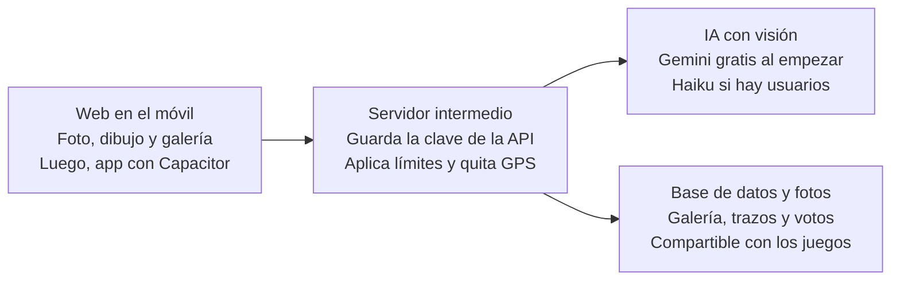

# Cloudex — app de fotos de nubes

4 de noviembre de 2026 · Iñigo

## La idea

Una app para hacer fotos de nubes, dibujar encima la forma que ves y que una IA te diga qué tipo de nube es y si se reconoce tu forma.

El usuario pone la parte creativa ("veo un dragón") y la IA la técnica ("es un cúmulo"). Sin saber nada de meteorología, se aprende jugando. Más adelante, la propia comunidad valida las fotos de los demás, y los logros mantienen la motivación.

## Decisiones tomadas

Cinco de las seis decisiones de base están cerradas; falta la privacidad de las fotos.

| Tema | Decisión | Nota |
| --- | --- | --- |
| Nombre | Cloudex (provisional) | Hay que darle una vuelta. Evitar "Claudex": se parece demasiado a la marca Claude |
| Idioma | Castellano | Otros idiomas, más adelante |
| Formas | Dibujo + texto libre | El usuario pinta el contorno y escribe qué ve; la IA asigna una categoría (animal, objeto, cara…) |
| Tipo de nube | Lo decide la IA | El usuario no tiene que saber nada |
| Login | Cuenta de Google | Cada uno con su galería; necesario para la comunidad |
| Privacidad | Por decidir | Ver último apartado |

## Flujo del usuario

Una foto pasa por cinco pasos, y la IA responde todo en una sola llamada.

1. Hace la foto o la sube desde la galería.
2. Pinta con el dedo el contorno de lo que ve.
3. Escribe qué es: "dragón con sombrero".
4. La IA devuelve, en un JSON:
   - si es una foto de cielo válida (antitrampas),
   - el tipo de nube, con un "probablemente" cuando dude y una frase explicativa,
   - la categoría de la forma,
   - una nota de 0 a 10 de si se reconoce la forma, con un comentario corto.
5. Se guarda en su galería con las dos etiquetas: *Dragón · Cumulonimbo*.

**Cómo la ven los demás:** la foto aparece limpia, sin nada encima. Un botón tipo "Ver el dibujo de su autor" superpone el trazo, y ahí descubres lo que vio la otra persona. Por eso el trazo se guarda aparte, como una capa, y no pegado a la foto.

## Qué IA usar y cuánto cuesta

Empezar gratis con Gemini Flash y dejar el proveedor intercambiable; si hay usuarios reales, Claude Haiku cuesta céntimos por cada mil fotos.

Las suscripciones Pro (Claude, Google) no cubren estas llamadas: van por API, que se paga aparte por uso. Hace falta un modelo con visión; los dos de abajo la tienen.

| Opción | Precio | A favor | En contra |
| --- | --- | --- | --- |
| [Gemini Flash / Flash-Lite](https://yingtu.ai/en/blog/google-gemini-api-free-tier-limits-2026) (capa gratuita) | 0 € | Ideal para desarrollar y probar | Límites diarios bajos que Google ya recortó en diciembre de 2025; en la capa gratis, Google puede usar lo que envías para mejorar sus productos |
| [Claude Haiku 5.5](https://pricepertoken.com/pricing-page/model/anthropic-claude-haiku-5.5) | 0,10 $ por millón de tokens de entrada, 0,50 $ de salida | Muy barato y fiable; mismo ecosistema que usas para programar | Requiere añadir saldo |

**Estimación por foto con Haiku:** una imagen ronda los [1.200 tokens](https://claude-api-cookbook.vercel.app/anthropic-api-pricing-2026/). Con instrucciones y respuesta, unos 1.500 de entrada y 300 de salida: unos 0,0003 $ por foto, unos 0,30 $ cada mil fotos (aproximado; comprobar con las primeras llamadas reales).

**Lo que sí hay que poner:** un tope de gasto mensual en la cuenta de la API y un límite de fotos diarias por usuario.

## Tecnología

Web primero, empaquetada como app con Capacitor cuando toque, usando la misma base en todos los proyectos.

La web nunca habla directamente con la IA: si la clave estuviera en el móvil, cualquiera podría sacarla y gastar tu saldo. El servidor intermedio puede ser el mismo que el de los rankings de los juegos.

## Fases

Cuatro fases, y solo la primera hace falta para tener algo que enseñar en LinkedIn.

1. **Versión mínima (web):** login con Google, foto, dibujo, texto, veredicto de la IA y galería personal.
2. **Logros:** álbum de los 10 tipos de nube, colección de formas por categorías, rachas de días y combinaciones ("un animal en cada tipo de nube").
3. **Comunidad:** feed con fotos de otros, el botón de ver el dibujo del autor, votos ("yo también veo el dragón") y nota mixta IA + personas. Incluye moderación.
4. **App:** empaquetar con Capacitor y publicar en las tiendas.

## Pendiente y próximos pasos

Quedan tres decisiones abiertas antes de empezar a programar.

- **Nombre definitivo.** Otras ideas: Nubidex, Cielario, Hodei, Skydex, Mira arriba.
- **Privacidad de las fotos.** Propuesta: privadas en la versión mínima (aún no hay comunidad) y que cada usuario elija al llegar la fase 3. Siempre se borra la ubicación GPS de la foto al subirla.
- **Límite diario de fotos.** Depende del coste real; 10 al día es un buen punto de partida.

- [ ] Elegir nombre
- [ ] Crear cuenta en Google AI Studio y probar Gemini con 5-10 fotos de nubes
- [ ] Crear el repositorio en GitHub y abrirlo como proyecto con Claude
- [ ] Construir la versión mínima
